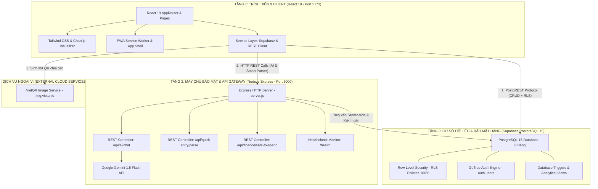
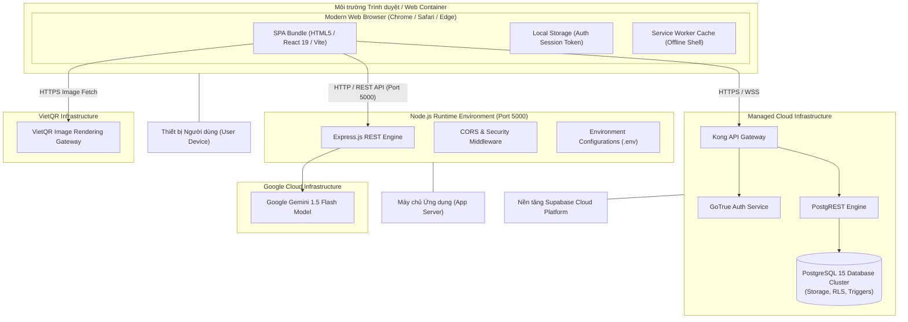
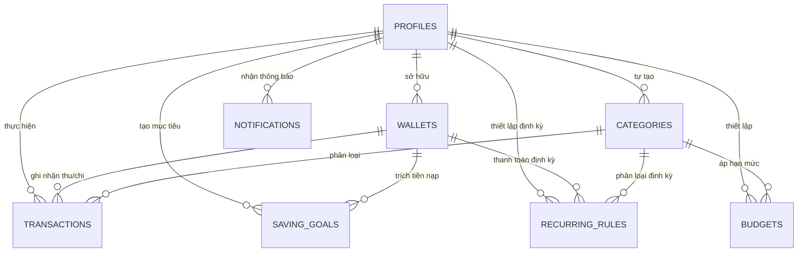

# BÁO CÁO THUYẾT MINH KIẾN TRÚC HỆ THỐNG & CƠ SỞ DỮ LIỆU (CHƯƠNG 4)

> **Tài liệu thuyết minh đồ án tốt nghiệp / đề tài:** SpendWise – Hệ thống quản lý chi tiêu cá nhân thông minh  
> **Chủ biên:** Leader – **Phan Thanh Tùng** (Project Manager & AI / Database Lead)  
> **Trạng thái:** Hoàn thiện 100% – Đồng bộ chính xác với mã nguồn thực tế.  

---

## 1. TỔNG QUAN KIẾN TRÚC HỆ THỐNG (HYBRID 3-TIER ARCHITECTURE)

Hệ thống SpendWise được thiết kế theo mô hình kiến trúc **3 tầng phân tán kết hợp (Hybrid 3-Tier Architecture)**, kết hợp linh hoạt giữa kiến trúc Backend-as-a-Service (BaaS) và máy chủ API Gateway độc lập:



### 1.1. Phân tích lý do lựa chọn mô hình Kiến trúc Hybrid
Thay vì chỉ dùng thuần BaaS hoặc thuần Monolithic Backend, SpendWise áp dụng mô hình lai (Hybrid) nhằm giải quyết 3 bài toán lớn:
1. **Tối ưu độ trễ & Trải nghiệm người dùng:** Các thao tác ghi chép thu/chi, xem danh mục, lọc ví được Client gọi trực tiếp qua PostgREST của Supabase. Tốc độ phản hồi đạt mức mili-giây, giảm tải tối đa cho máy chủ trung gian.
2. **Bảo mật tuyệt đối khóa bí mật (Gemini API Key):** Khóa `GEMINI_API_KEY` được cất giữ an toàn trên máy chủ Express Backend (`server/`). Phía Client gửi yêu cầu hỏi đáp lên Backend kèm Context, Backend thay mặt Client gọi đến Google Gemini API, triệt tiêu nguy cơ rò rỉ khóa bí mật trên trình duyệt người dùng.
3. **Khả năng dự phòng cao (Automatic Fallback):** Nếu máy chủ Backend tạm thời bảo trì hoặc chưa khởi động, Service Layer tại Client (`aiAssistantService.js`) tự động chuyển sang cơ chế Client-side SDK để duy trì trải nghiệm người dùng không bị gián đoạn.

---

## 2. SƠ ĐỒ TRIỂN KHAI HỆ THỐNG (UML DEPLOYMENT DIAGRAM)

Mô hình triển khai của SpendWise phân bổ trên các môi trường phân tán:



---

## 3. MÔ HÌNH THỰC THỂ QUAN HỆ (ERD) & TỪ ĐIỂN DỮ LIỆU

### 3.1. Sơ đồ Thực thể Quan hệ (ERD - 8 Bảng)



### 3.2. Từ điển dữ liệu chi tiết 8 bảng (Data Dictionary)

#### Bảng 1: `profiles` (Hồ sơ người dùng)
Lưu thông tin cá nhân mở rộng, liên kết 1-1 với tài khoản xác thực của Supabase Auth.
| Tên cột | Kiểu dữ liệu | Ràng buộc | Ý nghĩa nghiệp vụ |
| :--- | :--- | :--- | :--- |
| `id` | `UUID` | **PK**, FK `auth.users(id)` ON DELETE CASCADE | Mã định danh duy nhất của người dùng. |
| `full_name` | `TEXT` | NULL | Họ và tên hiển thị. |
| `avatar_url` | `TEXT` | NULL | Đường dẫn ảnh đại diện. |
| `default_bank_bin`| `TEXT` | NULL | Mã BIN ngân hàng mặc định (cho tiện ích VietQR). |
| `default_bank_account` | `TEXT` | NULL | Số tài khoản ngân hàng mặc định. |
| `created_at` | `TIMESTAMPTZ` | DEFAULT `NOW()` | Thời điểm tạo hồ sơ. |

#### Bảng 2: `wallets` (Ví tiền)
Quản lý các nguồn tiền độc lập của người dùng.
| Tên cột | Kiểu dữ liệu | Ràng buộc | Ý nghĩa nghiệp vụ |
| :--- | :--- | :--- | :--- |
| `id` | `UUID` | **PK**, DEFAULT `gen_random_uuid()` | Mã định danh ví. |
| `user_id` | `UUID` | **FK** `profiles(id)` ON DELETE CASCADE, NOT NULL | Người sở hữu ví. |
| `name` | `TEXT` | NOT NULL | Tên ví (VD: Tiền mặt, Vietcombank, MoMo). |
| `type` | `TEXT` | CHECK (`type IN ('cash','bank','ewallet')`) | Phân loại nguồn tiền. |
| `balance` | `NUMERIC(15,2)` | DEFAULT `0.00`, NOT NULL | Số dư khả dụng hiện tại. |
| `icon` | `TEXT` | DEFAULT `'Wallet'` | Tên biểu tượng hiển thị (Lucide Icons). |
| `color` | `TEXT` | DEFAULT `'#10B981'` | Mã màu nhận diện trên giao diện. |
| `is_archived`| `BOOLEAN` | DEFAULT `FALSE`, NOT NULL | Trạng thái ẩn/lưu trữ ví. |
| `created_at` | `TIMESTAMPTZ` | DEFAULT `NOW()` | Ngày tạo ví. |

#### Bảng 3: `categories` (Danh mục thu/chi)
Lưu trữ danh mục hệ thống dùng chung và danh mục cá nhân tự tạo.
| Tên cột | Kiểu dữ liệu | Ràng buộc | Ý nghĩa nghiệp vụ |
| :--- | :--- | :--- | :--- |
| `id` | `UUID` | **PK**, DEFAULT `gen_random_uuid()` | Mã danh mục. |
| `user_id` | `UUID` | **FK** `profiles(id)`, NULL cho danh mục hệ thống | Người tạo (NULL = Hệ thống mặc định). |
| `name` | `TEXT` | NOT NULL | Tên danh mục (Ăn uống, Tiền lương, Mua sắm...). |
| `type` | `TEXT` | CHECK (`type IN ('income', 'expense')`), NOT NULL | Loại dòng tiền (Thu nhập / Chi tiêu). |
| `keywords` | `TEXT[]` | DEFAULT `'{}'` | Mảng từ khóa không dấu hỗ trợ bộ phân tích Quick Entry. |
| `icon` | `TEXT` | DEFAULT `'Tag'` | Biểu tượng danh mục. |
| `color` | `TEXT` | DEFAULT `'#6B7280'` | Màu sắc phân loại. |
| `created_at` | `TIMESTAMPTZ` | DEFAULT `NOW()` | Ngày tạo. |

#### Bảng 4: `transactions` (Giao dịch thu/chi/chuyển tiền)
Bảng trung tâm ghi nhận toàn bộ biến động tài chính của người dùng.
| Tên cột | Kiểu dữ liệu | Ràng buộc | Ý nghĩa nghiệp vụ |
| :--- | :--- | :--- | :--- |
| `id` | `UUID` | **PK**, DEFAULT `gen_random_uuid()` | Mã giao dịch. |
| `user_id` | `UUID` | **FK** `profiles(id)` ON DELETE CASCADE, NOT NULL | Người thực hiện giao dịch. |
| `wallet_id` | `UUID` | **FK** `wallets(id)` ON DELETE RESTRICT, NOT NULL | Ví nguồn thanh toán/nhận tiền. |
| `to_wallet_id` | `UUID` | **FK** `wallets(id)` ON DELETE SET NULL, NULLABLE | Ví đích (chỉ dùng cho giao dịch `transfer`). |
| `category_id` | `UUID` | **FK** `categories(id)` ON DELETE SET NULL, NULLABLE | Danh mục chi tiêu/thu nhập. |
| `type` | `TEXT` | CHECK (`type IN ('income', 'expense', 'transfer')`) | Phân loại giao dịch. |
| `amount` | `NUMERIC(15,2)` | CHECK (`amount > 0`), NOT NULL | Số tiền phát sinh (luôn dương). |
| `transaction_date` | `DATE` | DEFAULT `CURRENT_DATE`, NOT NULL | Ngày phát sinh giao dịch. |
| `note` | `TEXT` | NULL | Ghi chú gốc của người dùng. |
| `note_unaccent` | `TEXT` | NULL (Tự động cập nhật bởi Trigger) | Ghi chú đã loại bỏ dấu tiếng Việt để tìm kiếm. |
| `created_at` | `TIMESTAMPTZ` | DEFAULT `NOW()` | Thời điểm ghi nhận vào hệ thống. |

#### Bảng 5: `budgets` (Ngân sách chi tiêu tháng)
Thiết lập hạn mức chi tiêu tối đa cho từng danh mục trong tháng.
| Tên cột | Kiểu dữ liệu | Ràng buộc | Ý nghĩa nghiệp vụ |
| :--- | :--- | :--- | :--- |
| `id` | `UUID` | **PK**, DEFAULT `gen_random_uuid()` | Mã ngân sách. |
| `user_id` | `UUID` | **FK** `profiles(id)` ON DELETE CASCADE, NOT NULL | Người thiết lập hạn mức. |
| `category_id` | `UUID` | **FK** `categories(id)` ON DELETE CASCADE, NOT NULL | Danh mục được áp hạn mức. |
| `month` | `INT` | CHECK (`month BETWEEN 1 AND 12`), NOT NULL | Tháng áp dụng. |
| `year` | `INT` | CHECK (`year >= 2024`), NOT NULL | Năm áp dụng. |
| `amount_limit` | `NUMERIC(15,2)` | CHECK (`amount_limit > 0`), NOT NULL | Hạn mức chi tiêu tối đa cho phép. |
| `created_at` | `TIMESTAMPTZ` | DEFAULT `NOW()` | Ngày khởi tạo. |

#### Bảng 6: `saving_goals` (Mục tiêu tiết kiệm)
Theo dõi các khoản tiền tích lũy cho mục tiêu tương lai.
| Tên cột | Kiểu dữ liệu | Ràng buộc | Ý nghĩa nghiệp vụ |
| :--- | :--- | :--- | :--- |
| `id` | `UUID` | **PK**, DEFAULT `gen_random_uuid()` | Mã mục tiêu. |
| `user_id` | `UUID` | **FK** `profiles(id)` ON DELETE CASCADE, NOT NULL | Người sở hữu mục tiêu. |
| `wallet_id` | `UUID` | **FK** `wallets(id)` ON DELETE SET NULL, NULLABLE | Ví liên kết trích tiền nạp. |
| `name` | `TEXT` | NOT NULL | Tên mục tiêu (Mua laptop, Quỹ du lịch...). |
| `target_amount` | `NUMERIC(15,2)` | CHECK (`target_amount > 0`), NOT NULL | Số tiền mục tiêu cần đạt. |
| `current_amount`| `NUMERIC(15,2)` | DEFAULT `0.00`, NOT NULL | Số tiền đã tích lũy hiện tại. |
| `deadline` | `DATE` | NULL | Ngày dự kiến hoàn thành. |
| `status` | `TEXT` | CHECK (`status IN ('in_progress', 'completed')`) | Trạng thái tiến độ. |
| `created_at` | `TIMESTAMPTZ` | DEFAULT `NOW()` | Ngày tạo. |

#### Bảng 7: `recurring_rules` (Quy tắc giao dịch định kỳ)
Tự động nhắc nhở và lên lịch thu/chi lặp lại theo chu kỳ.
| Tên cột | Kiểu dữ liệu | Ràng buộc | Ý nghĩa nghiệp vụ |
| :--- | :--- | :--- | :--- |
| `id` | `UUID` | **PK**, DEFAULT `gen_random_uuid()` | Mã quy tắc định kỳ. |
| `user_id` | `UUID` | **FK** `profiles(id)` ON DELETE CASCADE, NOT NULL | Người tạo quy tắc. |
| `wallet_id` | `UUID` | **FK** `wallets(id)` ON DELETE RESTRICT, NOT NULL | Ví nguồn thực hiện. |
| `category_id` | `UUID` | **FK** `categories(id)` ON DELETE RESTRICT, NOT NULL | Danh mục định kỳ. |
| `title` | `TEXT` | NOT NULL | Tên khoản định kỳ (Tiền trọ, Tiền mạng, Lương). |
| `type` | `TEXT` | CHECK (`type IN ('income', 'expense')`), NOT NULL | Khoản thu hay chi định kỳ. |
| `amount` | `NUMERIC(15,2)` | CHECK (`amount > 0`), NOT NULL | Số tiền lặp lại mỗi kỳ. |
| `frequency` | `TEXT` | CHECK (`frequency IN ('daily','weekly','monthly')`) | Tần suất lặp lại. |
| `day_of_month` | `INT` | CHECK (`day_of_month BETWEEN 1 AND 31`), NOT NULL | Ngày trong tháng đến hạn thanh toán. |
| `next_due_date`| `DATE` | NOT NULL | Ngày đến hạn tiếp theo gần nhất. |
| `is_active` | `BOOLEAN` | DEFAULT `TRUE`, NOT NULL | Đang kích hoạt hay tạm dừng. |
| `created_at` | `TIMESTAMPTZ` | DEFAULT `NOW()` | Ngày tạo quy tắc. |

#### Bảng 8: `notifications` (Thông báo hệ thống)
Lưu trữ các cảnh báo ngân sách, lời nhắc định kỳ và biến động tài chính.
| Tên cột | Kiểu dữ liệu | Ràng buộc | Ý nghĩa nghiệp vụ |
| :--- | :--- | :--- | :--- |
| `id` | `UUID` | **PK**, DEFAULT `gen_random_uuid()` | Mã thông báo. |
| `user_id` | `UUID` | **FK** `profiles(id)` ON DELETE CASCADE, NOT NULL | Người nhận thông báo. |
| `title` | `TEXT` | NOT NULL | Tiêu đề thông báo ngắn gọn. |
| `message` | `TEXT` | NOT NULL | Nội dung chi tiết thông báo. |
| `type` | `TEXT` | CHECK (`type IN ('budget_warning', 'recurring_due', 'system')`) | Loại thông báo. |
| `is_read` | `BOOLEAN` | DEFAULT `FALSE`, NOT NULL | Trạng thái đã đọc / chưa đọc. |
| `created_at` | `TIMESTAMPTZ` | DEFAULT `NOW()` | Thời điểm tạo thông báo. |

---

## 4. CHÍNH SÁCH BẢO MẬT HÀNG (ROW LEVEL SECURITY - RLS)

SpendWise áp dụng nguyên tắc **Zero Trust** đối với tầng dữ liệu: Bật RLS trên **100% các bảng** (`ALTER TABLE <name> ENABLE ROW LEVEL SECURITY;`).

```sql
-- Ví dụ: Chính sách kiểm soát dữ liệu độc quyền trên bảng transactions
CREATE POLICY "Users can only access their own transactions"
ON public.transactions
FOR ALL
USING (auth.uid() = user_id)
WITH CHECK (auth.uid() = user_id);
```

### 4.1. Ma trận phân quyền RLS trên toàn hệ thống

| Bảng dữ liệu | Quyền SELECT | Quyền INSERT | Quyền UPDATE | Quyền DELETE |
| :--- | :--- | :--- | :--- | :--- |
| `profiles` | `auth.uid() = id` | Tự động qua Trigger | `auth.uid() = id` | Cascade theo User |
| `wallets` | `auth.uid() = user_id` | `auth.uid() = user_id` | `auth.uid() = user_id` | `auth.uid() = user_id` |
| `categories` | `user_id IS NULL OR user_id = auth.uid()` | `auth.uid() = user_id` | `auth.uid() = user_id` | `auth.uid() = user_id` |
| `transactions` | `auth.uid() = user_id` | `auth.uid() = user_id` | `auth.uid() = user_id` | `auth.uid() = user_id` |
| `budgets` | `auth.uid() = user_id` | `auth.uid() = user_id` | `auth.uid() = user_id` | `auth.uid() = user_id` |
| `saving_goals`| `auth.uid() = user_id` | `auth.uid() = user_id` | `auth.uid() = user_id` | `auth.uid() = user_id` |
| `recurring_rules`| `auth.uid() = user_id`| `auth.uid() = user_id` | `auth.uid() = user_id` | `auth.uid() = user_id` |
| `notifications`| `auth.uid() = user_id`| Hệ thống / Server | `auth.uid() = user_id` | `auth.uid() = user_id` |

### 4.2. Hiệu quả an ninh mạng
* **Triệt tiêu lỗ hổng IDOR (Insecure Direct Object References):** Ngay cả khi tin tặc cố tình sửa đổi `transaction_id` hay `wallet_id` trên đường dẫn URL, câu truy vấn SQL tại tầng PostgreSQL sẽ tự động bổ sung điều kiện `WHERE user_id = auth.uid()`. Kết quả trả về sẽ là mảng rỗng (0 bản ghi), tuyệt đối không để lộ dữ liệu của người dùng khác.
* **Ngăn chặn SQL Injection:** Tất cả tham số truy vấn qua Supabase Client đều được chuẩn hóa dạng Parameterized Query.

---

## 5. TỰ ĐỘNG HÓA VỚI DATABASE TRIGGERS & ANALYTICAL VIEWS

### 5.1. Trigger Khởi tạo Hồ sơ & Ví mặc định (`on_auth_user_created`)
* **Mục đích:** Tự động tạo bản ghi `profiles` và ví "Tiền mặt" ban đầu ngay khi người dùng đăng ký tài khoản thành công qua Supabase Auth.
* **Mã nguồn kích hoạt:**
```sql
CREATE OR REPLACE FUNCTION public.handle_new_user()
RETURNS trigger AS $$
BEGIN
  -- 1. Tạo hồ sơ người dùng
  INSERT INTO public.profiles (id, full_name, avatar_url)
  VALUES (new.id, new.raw_user_meta_data->>'full_name', new.raw_user_meta_data->>'avatar_url');

  -- 2. Khởi tạo ví tiền mặt mặc định
  INSERT INTO public.wallets (user_id, name, type, balance, icon, color)
  VALUES (new.id, 'Tiền mặt', 'cash', 0.00, 'Wallet', '#10B981');

  RETURN NEW;
END;
$$ LANGUAGE plpgsql SECURITY DEFINER;

CREATE TRIGGER on_auth_user_created
  AFTER INSERT ON auth.users
  FOR EACH ROW EXECUTE PROCEDURE public.handle_new_user();
```

### 5.2. Trigger Tự động Chuẩn hóa Tiếng Việt không dấu (`trg_transactions_unaccent`)
* **Mục đích:** Khi thêm mới hoặc chỉnh sửa cột `note` trong `transactions`, Trigger tự động chuyển đổi chuỗi tiếng Việt có dấu sang không dấu lưu vào cột `note_unaccent`. Giúp tính năng tìm kiếm giao dịch phía người dùng đạt tốc độ tìm kiếm cực cao (sử dụng chỉ mục B-Tree / GIN).

### 5.3. Analytical SQL Views phục vụ Báo cáo & Dashboard
1. `v_monthly_summary`: Tổng hợp thu nhập, chi tiêu và số dư ròng theo từng tháng của từng người dùng.
2. `v_budget_progress`: Tính toán tự động tỷ lệ % đã chi tiêu trên hạn mức ngân sách (`spent_amount / amount_limit * 100`) và gắn cờ trạng thái (`normal`, `warning`, `exceeded`).

---

## 6. ĐẶC TẢ GIAO DIỆN LẬP TRÌNH ỨNG DỤNG (REST API SPECIFICATION)

Máy chủ Node.js Express (`server/server.js`) cung cấp các REST API endpoints chuyên biệt phục vụ các tác vụ nâng cao:

| Phương thức | Endpoint URL | Mục đích nghiệp vụ | Tham số đầu vào (Body JSON) | Dữ liệu trả về (Response) |
| :---: | :--- | :--- | :--- | :--- |
| `POST` | `/api/ai/chat` | Hỏi đáp tài chính với Gemini 1.5 Flash | `{ "prompt": string, "context": object }` | `{ "success": true, "reply": string, "timestamp": string }` |
| `POST` | `/api/quick-entry/parse` | Bóc tách câu tự nhiên phía Server | `{ "sentence": string, "wallets": array, "categories": array }` | `{ "success": true, "parsed": object }` |
| `POST` | `/api/finance/safe-to-spend` | Tính toán chỉ số Safe-to-spend | `{ "budgetRemaining": number, "upcomingRecurring": number, "daysLeft": number }` | `{ "success": true, "safeToSpend": number }` |
| `GET` | `/health` | Kiểm tra trạng thái máy chủ | Không có | `{ "status": "UP", "uptime": number }` |

---

## 7. YÊU CẦU PHI CHỨC NĂNG & TIÊU CHUẨN THIẾT KẾ (NFRs)

1. **Hiệu năng (Performance):** 
   - Thời gian phản hồi của các thao tác CRUD dữ liệu thông qua PostgREST đạt dưới **150ms**.
   - Thời gian xử lý bóc tách câu tự nhiên bằng Regex tại client/server dưới **20ms**.
   - Build tối ưu hóa với Rollup/Vite, nén Gzip bundle JS còn dưới **250kB**.
2. **Khả năng sử dụng (Usability & Mobile-First):**
   - Đạt chuẩn thẩm mỹ Double-Bezel, hệ số tỷ lệ font chữ tương thích tối đa trên màn hình di động 360px – 430px và Desktop 1440px.
   - Hỗ trợ đầy đủ chế độ Giao diện Sáng / Tối (Light / Dark Mode).
3. **Độ tin cậy & Sẵn sàng (Reliability):**
   - Khả năng hoạt động ngoại tuyến cơ bản qua PWA Service Worker (hiển thị trang shell và thông báo mất mạng).
   - Cơ chế Dual-Path: Hệ thống không bị treo hay tê liệt tính năng AI nếu máy chủ backend chưa được khởi động.
