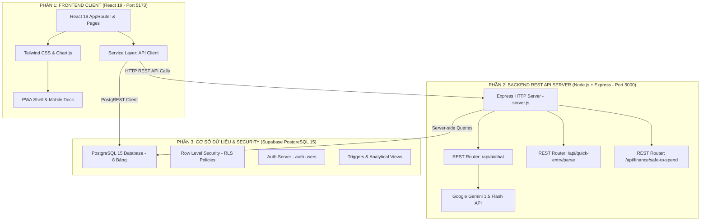
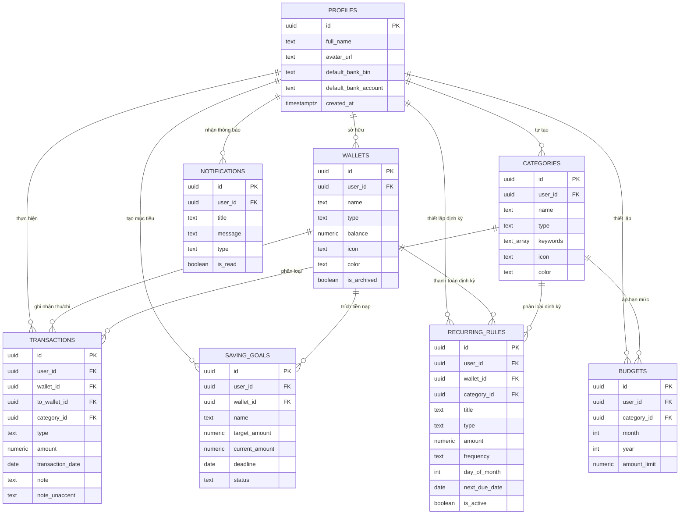

# THUYẾT MINH KIẾN TRÚC HỆ THỐNG & CƠ SỞ DỮ LIỆU (CHƯƠNG 4)

> **Tài liệu thuyết minh:** Phục vụ báo cáo thuyết minh đề tài SpendWise.
> **Chủ biên:** Leader – Phan Thanh Tùng (Project Manager & AI/DB Lead).

---

## 1. KIẾN TRÚC TÁCH BIỆT RÕ RÀNG GIỮA FRONTEND VÀ BACKEND

Hệ thống SpendWise được thiết kế theo mô hình **Client - Server - Database** phân định rõ ràng giữa hai phần Độc lập: **Frontend (Client)** và **Backend (Server)**:

### 1.1. Phân hệ Frontend (Client - Cổng 5173)
* **Công nghệ:** React 19, Vite, Tailwind CSS, Lucide Icons, Chart.js.
* **Đặc điểm:** Ứng dụng Web Responsive (Mobile-First) và Progressive Web App (PWA).
* **Nhiệm vụ:** Xử lý hiển thị giao diện 13 màn hình, tiếp nhận tương tác người dùng, hiển thị đồ thị trực quan và gọi API về máy chủ Backend.

### 1.2. Phân hệ Backend (Server - Cổng 5000)
* **Công nghệ:** Node.js, Express framework, CORS, Dotenv.
* **Đặc điểm:** Máy chủ REST API độc lập nằm tại thư mục `server/`.
* **Nhiệm vụ cốt lõi:**
  1. Bảo mật API Key của Google Gemini, không để lộ key xuống trình duyệt người dùng.
  2. Bóc tách câu tự nhiên (Quick Entry Parser) phía Server.
  3. Cung cấp API tính toán công thức Safe-to-spend.
  4. Cung cấp API Healthcheck giám sát hoạt động của hệ thống.

### 1.3. Phân hệ Cơ sở dữ liệu (Data Layer - Supabase PostgreSQL)
* **Công nghệ:** PostgreSQL 15, Supabase Auth, Row Level Security (RLS).
* Quản trị 8 bảng dữ liệu quan hệ, kiểm soát quyền truy cập qua Row Level Security (RLS).
* Hệ thống Trigger tự động hóa: sinh ví mặc định khi đăng ký, tự động bỏ dấu tiếng Việt `note_unaccent`.
* Cung cấp các Views thống kê: `v_monthly_summary`, `v_budget_progress`.
- **Row Level Security (RLS)**: Bật bảo mật trên 100% các bảng. Người dùng chỉ có quyền truy xuất các bản ghi có `user_id = auth.uid()`.
- **Database Triggers**:
  * `trg_transactions_unaccent`: Tự động loại bỏ dấu tiếng Việt khi thêm/sửa giao dịch vào cột `note_unaccent`.
  * `on_auth_user_created`: Bắt sự kiện tạo user mới để tự sinh bản ghi `profiles` và ví `Tiền mặt` mặc định.

---

## 2. MÔ HÌNH THỰC THỂ QUAN HỆ (ERD - 8 BẢNG)

