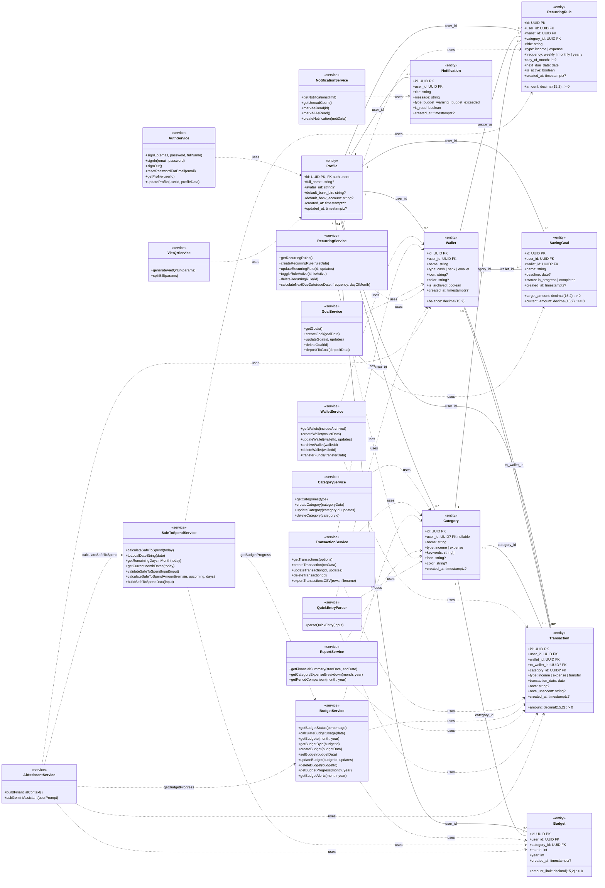

# SpendWise — Class Diagram tổng hợp (Service & Entity)

> **Phạm vi:** 8 bảng `public.*` trong Supabase và 13 module `src/services/*.js`. Cập nhật theo mã nguồn nhánh `main` tham chiếu ngày **01/11/2026**.

**Quan trọng:** JavaScript trong repository đang **export các hàm từ module**, không khai báo `class` ES6 tương ứng. Những `«service»` trong UML là **lớp khái niệm dùng để nhóm phương thức**, không phải khẳng định source code có class/instance thật. Các Entity là mô hình dữ liệu ánh xạ bảng PostgreSQL, không phải các class ORM đã tồn tại.

## 1. Kiến trúc và ký hiệu

`React UI → Service layer (Supabase Client / HTTP REST API) → Supabase PostgreSQL` và các thành phần ngoài DB như `Gemini`, `VietQR`.

- **1 / 0..1 / 0..***: Bội số theo cột FK; `?` cho phép NULL; `PK` và `FK` là khóa chính/ngoại.
- **Đường liền**: quan hệ giữa Entity theo FK. **Đường nét đứt**: Service sử dụng/biến đổi Entity hoặc phụ thuộc Service khác.
- `UUID`, `date`, `timestamptz`, `decimal(15,2)` ánh xạ trực tiếp kiểu SQL. Các trường `user_id` được Supabase RLS phân quyền theo `auth.uid()`.
- `profiles.id` tham chiếu `auth.users.id` (hệ thống auth ngoài 8 Entity); `Category.user_id = NULL` là danh mục dùng chung.

### Sơ đồ UML tổng hợp

> Mermaid tổng hợp chứa nhiều mối liên hệ; sử dụng file [`diagrams/class_diagram.drawio`](./diagrams/class_diagram.drawio) để xem ba trang bố cục rõ hơn và chỉnh sửa trực tiếp từng shape.

## 2. Danh sách 8 Entity và thuộc tính (đối chiếu SQL)

### 2.1. `Profile` ↔ `public.profiles` — Người dùng

| Thuộc tính và kiểu | Ghi chú |
|---|---|
| `id: UUID {PK, FK auth.users.id}` | Khóa chính / quan hệ |
| `full_name: string?` | Cột của bảng |
| `avatar_url: string?` | Cột của bảng |
| `default_bank_bin: string?` | Cột của bảng |
| `default_bank_account: string?` | Cột của bảng |
| `created_at: timestamptz?` | Cột của bảng |
| `updated_at: timestamptz?` | Cột của bảng |

### 2.2. `Wallet` ↔ `public.wallets` — Ví

| Thuộc tính và kiểu | Ghi chú |
|---|---|
| `id: UUID {PK}` | Khóa chính / quan hệ |
| `user_id: UUID {FK, NOT NULL}` | Khóa chính / quan hệ |
| `name: string` | Cột của bảng |
| `type: cash | bank | ewallet` | Cột của bảng |
| `balance: decimal(15,2)` | Cột của bảng |
| `icon: string?` | Cột của bảng |
| `color: string?` | Cột của bảng |
| `is_archived: boolean` | Cột của bảng |
| `created_at: timestamptz?` | Cột của bảng |

### 2.3. `Category` ↔ `public.categories` — Danh mục

| Thuộc tính và kiểu | Ghi chú |
|---|---|
| `id: UUID {PK}` | Khóa chính / quan hệ |
| `user_id: UUID? {FK; null = hệ thống}` | Khóa chính / quan hệ |
| `name: string` | Cột của bảng |
| `type: income | expense` | Cột của bảng |
| `keywords: string[]` | Cột của bảng |
| `icon: string?` | Cột của bảng |
| `color: string?` | Cột của bảng |
| `created_at: timestamptz?` | Cột của bảng |

### 2.4. `Transaction` ↔ `public.transactions` — Giao dịch

| Thuộc tính và kiểu | Ghi chú |
|---|---|
| `id: UUID {PK}` | Khóa chính / quan hệ |
| `user_id: UUID {FK}` | Khóa chính / quan hệ |
| `wallet_id: UUID {FK}` | Khóa chính / quan hệ |
| `to_wallet_id: UUID? {FK, transfer}` | Khóa chính / quan hệ |
| `category_id: UUID? {FK}` | Khóa chính / quan hệ |
| `type: income | expense | transfer` | Cột của bảng |
| `amount: decimal(15,2) > 0` | Cột của bảng |
| `transaction_date: date` | Cột của bảng |
| `note: string?` | Cột của bảng |
| `note_unaccent: string?` | Cột của bảng |
| `created_at: timestamptz?` | Cột của bảng |

### 2.5. `Budget` ↔ `public.budgets` — Ngân sách

| Thuộc tính và kiểu | Ghi chú |
|---|---|
| `id: UUID {PK}` | Khóa chính / quan hệ |
| `user_id: UUID {FK}` | Khóa chính / quan hệ |
| `category_id: UUID {FK}` | Khóa chính / quan hệ |
| `month: int [1..12]` | Cột của bảng |
| `year: int [>= 2020]` | Cột của bảng |
| `amount_limit: decimal(15,2) > 0` | Cột của bảng |
| `created_at: timestamptz?` | Cột của bảng |
| `UNIQUE(user_id, category_id, month, year)` | Unique tổng hợp |

### 2.6. `SavingGoal` ↔ `public.saving_goals` — Mục tiêu tiết kiệm

| Thuộc tính và kiểu | Ghi chú |
|---|---|
| `id: UUID {PK}` | Khóa chính / quan hệ |
| `user_id: UUID {FK}` | Khóa chính / quan hệ |
| `wallet_id: UUID? {FK}` | Khóa chính / quan hệ |
| `name: string` | Cột của bảng |
| `target_amount: decimal(15,2) > 0` | Cột của bảng |
| `current_amount: decimal(15,2) >= 0` | Cột của bảng |
| `deadline: date?` | Cột của bảng |
| `status: in_progress | completed` | Cột của bảng |
| `created_at: timestamptz?` | Cột của bảng |

### 2.7. `RecurringRule` ↔ `public.recurring_rules` — Giao dịch định kỳ

| Thuộc tính và kiểu | Ghi chú |
|---|---|
| `id: UUID {PK}` | Khóa chính / quan hệ |
| `user_id: UUID {FK}` | Khóa chính / quan hệ |
| `wallet_id: UUID {FK}` | Khóa chính / quan hệ |
| `category_id: UUID {FK}` | Khóa chính / quan hệ |
| `title: string` | Cột của bảng |
| `type: income | expense` | Cột của bảng |
| `amount: decimal(15,2) > 0` | Cột của bảng |
| `frequency: weekly | monthly | yearly` | Cột của bảng |
| `day_of_month: int? [1..31]` | Cột của bảng |
| `next_due_date: date` | Cột của bảng |
| `is_active: boolean` | Cột của bảng |
| `created_at: timestamptz?` | Cột của bảng |

### 2.8. `Notification` ↔ `public.notifications` — Thông báo

| Thuộc tính và kiểu | Ghi chú |
|---|---|
| `id: UUID {PK}` | Khóa chính / quan hệ |
| `user_id: UUID {FK}` | Khóa chính / quan hệ |
| `title: string` | Cột của bảng |
| `message: string` | Cột của bảng |
| `type: budget_warning | budget_exceeded` | Cột của bảng |
| `is_read: boolean` | Cột của bảng |
| `created_at: timestamptz?` | Cột của bảng |

### 2.9. Bội số FK cần thể hiện

| Entity cha | Entity con | Khóa ngoại / vai trò | Phía cha | Phía con |
|---|---|---|---|---|
| `Profile` | `Wallet` | `user_id` | `1` | `0..*` |
| `Profile` | `Category` | `user_id (nullable)` | `0..1` | `0..*` |
| `Profile` | `Transaction` | `user_id` | `1` | `0..*` |
| `Profile` | `Budget` | `user_id` | `1` | `0..*` |
| `Profile` | `SavingGoal` | `user_id` | `1` | `0..*` |
| `Profile` | `RecurringRule` | `user_id` | `1` | `0..*` |
| `Profile` | `Notification` | `user_id` | `1` | `0..*` |
| `Wallet` | `Transaction` | `wallet_id (nguồn)` | `1` | `0..*` |
| `Wallet` | `Transaction` | `to_wallet_id (đích)` | `0..1` | `0..*` |
| `Wallet` | `SavingGoal` | `wallet_id (nullable)` | `0..1` | `0..*` |
| `Wallet` | `RecurringRule` | `wallet_id` | `1` | `0..*` |
| `Category` | `Transaction` | `category_id (nullable)` | `0..1` | `0..*` |
| `Category` | `Budget` | `category_id` | `1` | `0..*` |
| `Category` | `RecurringRule` | `category_id` | `1` | `0..*` |

**Lưu ý:** `Transaction` có **hai** liên kết với `Wallet`: `wallet_id` (bắt buộc, ví nguồn) và `to_wallet_id` (có thể NULL, ví nhận khi chuyển nội bộ). Trường hợp `Category.user_id = NULL` là danh mục hệ thống không thuộc Profile riêng. `SavingGoal.wallet_id` và `Transaction.category_id` là nullable.

## 3. Các Service và phương thức công khai

Tất cả tên hàm dưới đây được đối chiếu với `export function`/`export async function` trong mã nguồn. Tham số `options`, `params`, `data` mang ý nghĩa object; kiểu trả về của hàm async thường là `Promise<{data, error}>` hoặc object tổng hợp chuyên biệt. Không mô tả chúng là static method thực tế của ES6 class.

### 3.1. `«service» AuthService` — Xác thực & hồ sơ

**Nguồn:** [`src/services/authService.js`](https://github.com/tungf2006/SpendWise/blob/main/src/services/authService.js)

- `+signUp(email, password, fullName = "")`
- `+signIn(email, password)`
- `+signOut()`
- `+resetPasswordForEmail(email)`
- `+getProfile(userId)`
- `+updateProfile(userId, profileData)`

### 3.2. `«service» WalletService` — Quản lý Ví

**Nguồn:** [`src/services/walletService.js`](https://github.com/tungf2006/SpendWise/blob/main/src/services/walletService.js)

- `+getWallets(includeArchived = false)`
- `+createWallet(walletData)`
- `+updateWallet(walletId, updates)`
- `+archiveWallet(walletId)`
- `+deleteWallet(walletId)`
- `+transferFunds(transferData)`

### 3.3. `«service» CategoryService` — Danh mục

**Nguồn:** [`src/services/categoryService.js`](https://github.com/tungf2006/SpendWise/blob/main/src/services/categoryService.js)

- `+getCategories(type = null)`
- `+createCategory(categoryData)`
- `+updateCategory(categoryId, updates)`
- `+deleteCategory(categoryId)`

### 3.4. `«service» TransactionService` — Giao dịch

**Nguồn:** [`src/services/transactionService.js`](https://github.com/tungf2006/SpendWise/blob/main/src/services/transactionService.js)

- `+getTransactions(options = {})`
- `+createTransaction(txnData)`
- `+updateTransaction(id, updates)`
- `+deleteTransaction(id)`
- `+exportTransactionsCSV(rows, filename)`

### 3.5. `«service» BudgetService` — Ngân sách

**Nguồn:** [`src/services/budgetService.js`](https://github.com/tungf2006/SpendWise/blob/main/src/services/budgetService.js)

- `+getBudgetStatus(percentage)`
- `+calculateBudgetUsage(data)`
- `+getBudgets(month, year)`
- `+getBudgetById(budgetId)`
- `+createBudget(budgetData)`
- `+setBudget(budgetData)`
- `+updateBudget(budgetId, updates)`
- `+deleteBudget(budgetId)`
- `+getBudgetProgress(month, year)`
- `+getBudgetAlerts(month, year)`

### 3.6. `«service» ReportService` — Báo cáo

**Nguồn:** [`src/services/reportService.js`](https://github.com/tungf2006/SpendWise/blob/main/src/services/reportService.js)

- `+getFinancialSummary(startDate, endDate)`
- `+getCategoryExpenseBreakdown(month, year)`
- `+getPeriodComparison(month, year)`

### 3.7. `«service» GoalService` — Tiết kiệm

**Nguồn:** [`src/services/goalService.js`](https://github.com/tungf2006/SpendWise/blob/main/src/services/goalService.js)

- `+getGoals()`
- `+createGoal(goalData)`
- `+updateGoal(id, updates)`
- `+deleteGoal(id)`
- `+depositToGoal(depositData)`

### 3.8. `«service» RecurringService` — Định kỳ

**Nguồn:** [`src/services/recurringService.js`](https://github.com/tungf2006/SpendWise/blob/main/src/services/recurringService.js)

- `+getRecurringRules()`
- `+createRecurringRule(ruleData)`
- `+updateRecurringRule(id, updates)`
- `+toggleRuleActive(id, isActive)`
- `+deleteRecurringRule(id)`
- `+calculateNextDueDate(dueDate, frequency, dayOfMonth)`

### 3.9. `«service» NotificationService` — Thông báo

**Nguồn:** [`src/services/notificationService.js`](https://github.com/tungf2006/SpendWise/blob/main/src/services/notificationService.js)

- `+getNotifications(limit = 30)`
- `+getUnreadCount()`
- `+markAsRead(id)`
- `+markAllAsRead()`
- `+createNotification(notiData)`

### 3.10. `«service» QuickEntryParser` — Nhập nhanh (hàm thuần)

**Nguồn:** [`src/services/quickEntryParser.js`](https://github.com/tungf2006/SpendWise/blob/main/src/services/quickEntryParser.js)

- `+parseQuickEntry(input)`

### 3.11. `«service» SafeToSpendService` — Safe-to-spend

**Nguồn:** [`src/services/safeToSpendService.js`](https://github.com/tungf2006/SpendWise/blob/main/src/services/safeToSpendService.js)

- `+calculateSafeToSpend(today = new Date())`
- `+toLocalDateString(date)`
- `+getRemainingDaysInMonth(today)`
- `+getCurrentMonthDates(today)`
- `+validateSafeToSpendInput(input)`
- `+calculateSafeToSpendAmount(remain, upcoming, days)`
- `+buildSafeToSpendData(input)`

### 3.12. `«service» AiAssistantService` — Trợ lý Gemini

**Nguồn:** [`src/services/aiAssistantService.js`](https://github.com/tungf2006/SpendWise/blob/main/src/services/aiAssistantService.js)

- `+buildFinancialContext()`
- `+askGeminiAssistant(userPrompt)`

### 3.13. `«service» VietQrService` — VietQR & chia hóa đơn

**Nguồn:** [`src/services/vietqrService.js`](https://github.com/tungf2006/SpendWise/blob/main/src/services/vietqrService.js)

- `+generateVietQrUrl(params)`
- `+splitBill(params)`

## 4. Ma trận phụ thuộc giữa Service và Entity

| Service | Entity liên quan | Bản chất |
|---|---|---|
| `AuthService` | `Profile` | Đọc / ghi hoặc tổng hợp dữ liệu theo các phương thức service |
| `WalletService` | `Wallet`, `Transaction` | Đọc / ghi hoặc tổng hợp dữ liệu theo các phương thức service |
| `CategoryService` | `Category` | Đọc / ghi hoặc tổng hợp dữ liệu theo các phương thức service |
| `TransactionService` | `Transaction`, `Wallet`, `Category` | Đọc / ghi hoặc tổng hợp dữ liệu theo các phương thức service |
| `BudgetService` | `Budget`, `Category`, `Transaction` | Đọc / ghi hoặc tổng hợp dữ liệu theo các phương thức service |
| `ReportService` | `Transaction`, `Category` | Đọc / ghi hoặc tổng hợp dữ liệu theo các phương thức service |
| `GoalService` | `SavingGoal`, `Wallet` | Đọc / ghi hoặc tổng hợp dữ liệu theo các phương thức service |
| `RecurringService` | `RecurringRule`, `Wallet`, `Category` | Đọc / ghi hoặc tổng hợp dữ liệu theo các phương thức service |
| `NotificationService` | `Notification` | Đọc / ghi hoặc tổng hợp dữ liệu theo các phương thức service |
| `QuickEntryParser` | `Wallet`, `Category`, `Transaction` | Kết quả parse có ý nghĩa dữ liệu, **không truy vấn DB trực tiếp** |
| `SafeToSpendService` | `Budget`, `RecurringRule` | Đọc `recurring_rules` và dùng `getBudgetProgress()`; gọi REST API Safe-to-spend |
| `AiAssistantService` | `Wallet`, `Budget`, `Transaction` | Đọc dữ liệu tài chính, gọi `getBudgetProgress` và `calculateSafeToSpend` |
| `VietQrService` | `Profile` | Dùng thông tin ngân hàng cấu hình trong Profile ở tầng UI; **không truy vấn Profile trực tiếp** |

**Phụ thuộc Service → Service thực tế:**

- `SafeToSpendService` gọi `BudgetService.getBudgetProgress()`
- `AiAssistantService` gọi `BudgetService.getBudgetProgress()`
- `AiAssistantService` gọi `SafeToSpendService.calculateSafeToSpend()`

## 5. Quy tắc nghiệp vụ và giới hạn mô hình

1. **Ngân sách:** `BudgetService.getBudgetStatus(percentage)` phân loại **an toàn** nếu `< 80%`, **sắp vượt** nếu `80% ≤ % < 100%`, **đã vượt** nếu `≥ 100%`. Một danh mục có tối đa một ngân sách cho mỗi user/tháng/năm (ràng buộc UNIQUE).
2. **Safe-to-spend:** `max(0, (RemainingBudget - UpcomingRecurringExpenses) / RemainingDaysInMonth)` với ngày còn lại tính cả hôm nay. Truy vấn thu/chi không được tính `transfer` thành chi phí.
3. **Giao dịch định kỳ:** Mã nguồn được đối chiếu có `calculateNextDueDate()` và CRUD, **chưa có** export `checkAndGenerateRecurringTransactions()` trong `recurringService.js` trên nhánh tham chiếu. Nếu bổ sung chức năng sinh tự động, hãy cập nhật sơ đồ với `RecurringService → TransactionService` hoặc luồng backend tương ứng.
4. **Nhập nhanh:** `parseQuickEntry(input)` là hàm rule-based chỉ tạo dữ liệu xem trước; lưu giao dịch do UI xác nhận thông qua `createTransaction()` thay vì parser tự ghi DB.
5. **Cập nhật số dư:** `TransactionService`/`WalletService`/`GoalService` trong source có các thao tác đọc–ghi nhiều bước. Khi triển khai production, các luồng chuyển/nạp/hoàn tiền cần transaction SQL/RPC nguyên tử để tránh cập nhật dở dang.
6. **Bảo mật:** RLS gắn với user đang đăng nhập; riêng `categories` cho phép đọc danh mục chung (`user_id IS NULL`) và chỉ sửa/xóa danh mục của chính người dùng.
7. **Thành phần ngoài 8 bảng:** `auth.users`, view `v_budget_progress`, `v_monthly_summary` và HTTP/Gemini/VietQR là hạ tầng hoặc view, **không tính** vào 8 Entity.

## 6. Hướng dẫn sử dụng bản vẽ

1. Tải `docs/diagrams/class_diagram.drawio`; mở bằng [diagrams.net](https://app.diagrams.net/) hoặc draw.io desktop qua **File → Open from → Device**.
2. Chuyển giữa 3 trang: **Tổng hợp 21 lớp**, **8 Entity & khóa ngoại**, **13 Service & phương thức**. Tất cả khối lớp là các group/shape có thể chỉnh sửa tên, thuộc tính, phương thức và liên kết.
3. Nếu dùng GitHub Markdown có Mermaid, xem trực tiếp phần **Sơ đồ UML tổng hợp** trong file này.
4. Sao chép cả `class_diagram.md` và `diagrams/class_diagram.drawio` vào thư mục `docs/` của repo; giữ đúng đường dẫn tương đối để link trong Markdown hoạt động.

## 7. Tài liệu nguồn

- [Repository SpendWise](https://github.com/tungf2006/SpendWise)
- [SQL schema — `supabase/init_schema.sql`](https://github.com/tungf2006/SpendWise/blob/main/supabase/init_schema.sql)
- [Kiến trúc và ERD 8 bảng](https://github.com/tungf2006/SpendWise/blob/main/docs/architecture/ARCHITECTURE.md)
- [Quy tắc thuật ngữ SpendWise](https://github.com/tungf2006/SpendWise/blob/main/docs/AI_RULES.md)
- [Cấu trúc Service và phân công](https://github.com/tungf2006/SpendWise/blob/main/HUONG_DAN_LAM_VIEC.md)
